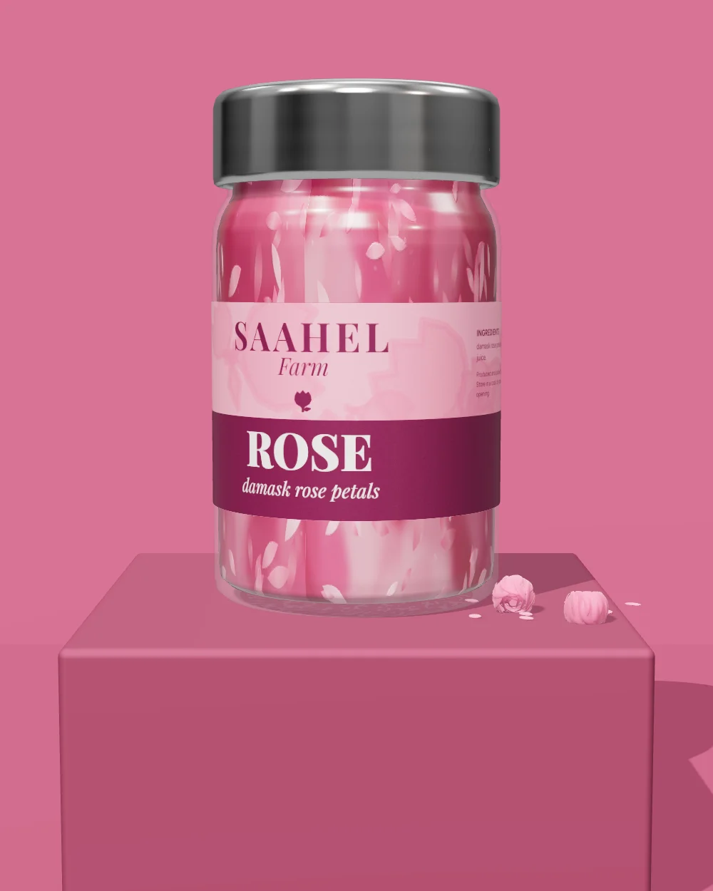
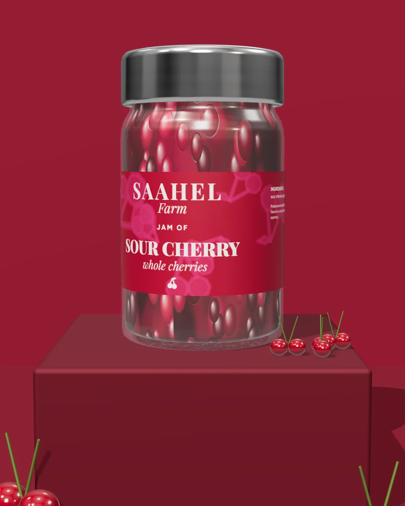
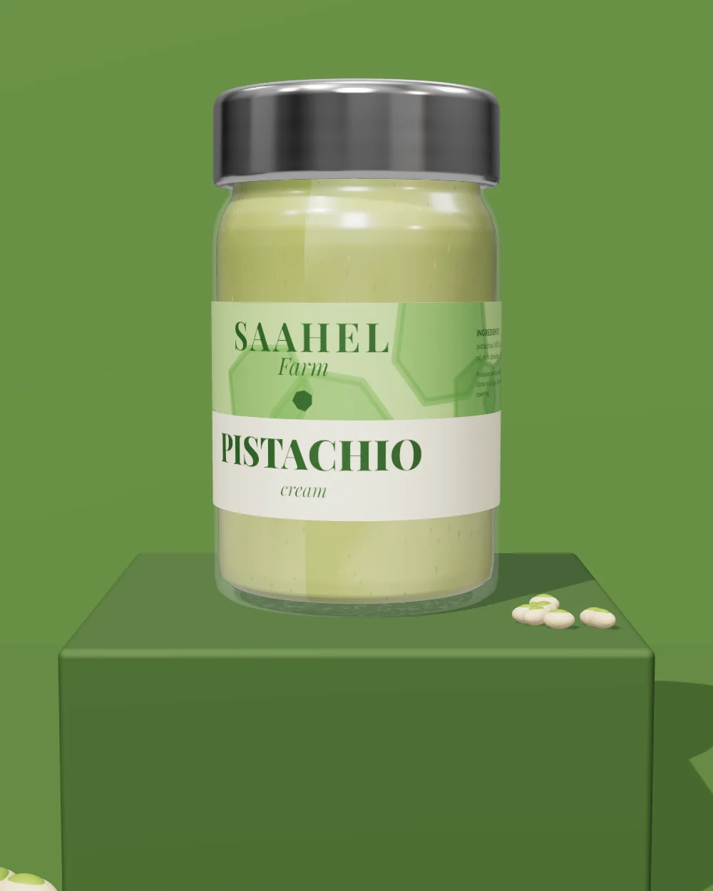

# Saahel Farm 🍯

An animated, bilingual (English / Türkçe) storefront for a small farm pantry: jams, sweet creams and preserves.
Each product label is drawn on a `<canvas>` and wrapped around a real jar photo, so it spins when you hover.

**Plain HTML, CSS and JavaScript.** No framework, no build step, no dependencies. Open it and it runs.

**▶ Live demo:** https://farshadrp.github.io/saahel-farm/

<p align="center">
  
  
  
</p>

## Features

- **Intro loader**: fruit falls and fills the screen while a counter runs to 100%, then an orange band sweeps it away
- **Jar carousel**: an endless, tilted row of jars you can scroll, swipe or drag, with inertia, focus scaling and depth blur
- **Wrap-around labels**: a flat label image is mapped onto the curved jar on a canvas and rotates on hover
- **Rotating circular text** clipped inside a blob shape
- **Product pages**: gallery, ingredients, tips, weights and a draggable "other products" track
- **Two languages (EN / TR)** from a single content file, with RTL-ready layout code
- Custom cursor badge, page transitions, and a header that hides on scroll
- Responsive on mobile and desktop, with touch and pointer support

## Run it locally

Any static server works:

```bash
git clone https://github.com/farshadrp/saahel-farm.git
cd saahel-farm
npx serve .          # or: python -m http.server 8000
```

Then open `http://localhost:3000` (or `:8000`).

> Opening `index.html` straight from disk mostly works too, but canvas images load more reliably over a local server.

## Make it yours

All content lives in **[`assets/js/products.js`](assets/js/products.js)**: brand name, menu labels, footer text and every product, in both languages.

Each product uses three kinds of images, all named after its `slug`:

| Folder | What goes in it |
| --- | --- |
| `assets/img/jars/` | Jar photo **without** a label, on a transparent background |
| `assets/img/labels/` | The flat, unrolled label artwork (the full wrap-around) |
| `assets/img/photos/` | Three gallery photos: `-studio`, `-nature` and `-table` |

If your jar photos are framed differently, adjust `SITE.jarLabel` at the top of `products.js`. These are fractions of the photo size that mark where the label band sits. You can also override them for a single product with `jarLabel: { … }`.

## Project structure

```
├── index.html            → redirects to /en/
├── en/  tr/              → index.html (home) + product.html, one folder per language
└── assets/
    ├── css/style.css
    ├── js/
    │   ├── products.js   → all site content (edit this)
    │   ├── common.js     → header, menu, footer, cursor, transitions, draggable
    │   ├── jar-label.js  → canvas label wrapping
    │   ├── shapes.js     → fruit SVG shapes for the loader
    │   ├── home.js       → loader + jar carousel
    │   └── product.js    → product page
    └── img/
```

## Deploy on GitHub Pages

1. Fork this repo (or push your own copy)
2. Go to **Settings → Pages**
3. Under *Source*, choose **Deploy from a branch**, then pick `main` and `/ (root)`
4. Your site will be live at `https://<your-username>.github.io/saahel-farm/` within a minute or two

---

## راهنمای سریع (فارسی)

یک سایت فروشگاهی انیمیشنی و دوزبانه برای محصولات یک مزرعه، با HTML، CSS و JavaScript خالص و بدون نیاز به نصب یا build.

- **اجرا:** پروژه را دانلود یا clone کنید و با یک سرور ساده باز کنید (`npx serve .`).
- **تغییر محتوا:** متن‌ها و محصولات همه در فایل `assets/js/products.js` هستند.
- **عکس‌ها:** برای هر محصول یک عکس شیشه بدون برچسب، یک تصویر برچسب و سه عکس گالری لازم است.
- **انتشار رایگان:** با GitHub Pages، از مسیر Settings ← Pages.

اگر از اینستاگرام آمده‌اید و پروژه به کارتان آمد، یک ⭐ بدهید 🙌

## License

[MIT](LICENSE). Free to use, change and ship, including in commercial work.
